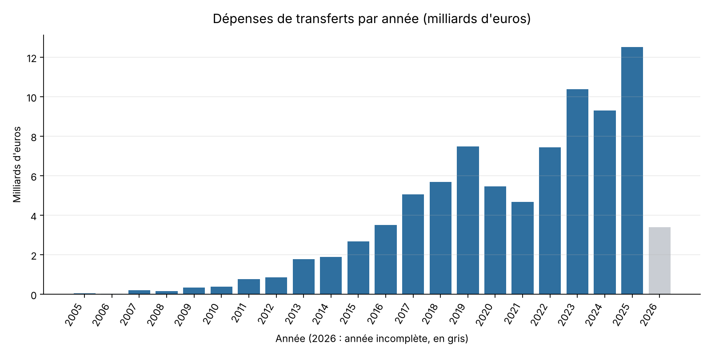
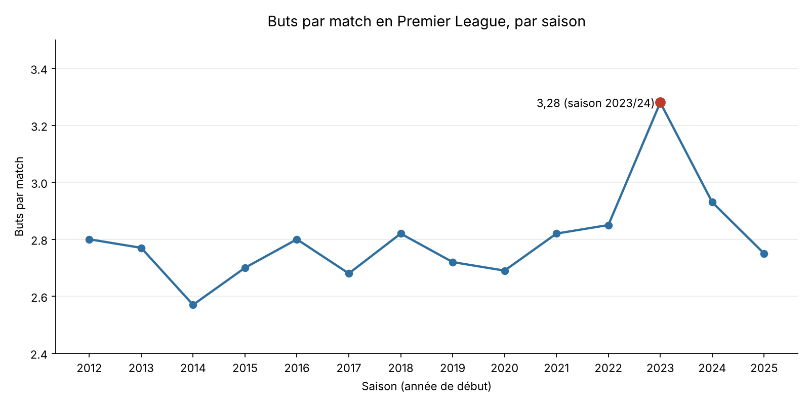

# Nettoyage et analyse de données football avec SQL (MySQL)

Projet de data cleaning et d'analyse SQL sur 7 tables de données football (Transfermarkt) : plus de **2,8 millions de lignes** explorées, contrôlées, nettoyées et validées avec MySQL.

## Objectif

Transformer des fichiers CSV bruts, importés en texte, en une base de données propre, typée et prête pour l'analyse, puis le démontrer avec 5 analyses concrètes.

## Les données

Jeu de données public issu de Transfermarkt, composé de 7 fichiers CSV.

| Table | Lignes | Contenu |
|---|---:|---|
| `appearances` | 1 894 350 | Une ligne par joueur et par match (buts, passes, minutes, cartons) |
| `player_valuations` | 656 301 | Historique des valeurs marchandes des joueurs |
| `transfers` | 175 165 | Transferts de joueurs entre clubs |
| `games` | 88 958 | Matchs (score, date, stade, arbitre, affluence) |
| `players` | 50 149 | Fiche de chaque joueur |
| `clubs` | 796 | Fiche de chaque club |
| `competitions` | 65 | Championnats et coupes |

> Source des données : [Football Data from Transfermarkt](https://www.kaggle.com/datasets/davidcariboo/player-scores) (jeu de données public sur Kaggle, par David Cariboo).

## Méthode

Pour chaque table, la même démarche en 4 étapes :

1. **Explorer** : aperçu, structure, nombre de lignes.
2. **Contrôler** : doublons, valeurs manquantes (`NULL` et cellules vides), formats numériques et dates, valeurs aberrantes.
3. **Nettoyer** : création d'une table propre avec les bons types, une clé primaire et des index.
4. **Valider** : comparaison des résultats avec les valeurs attendues, vérification qu'aucune ligne n'a été perdue.

Principe de sécurité : les données brutes restent intactes dans la base `raw_football`, tout le nettoyage est fait dans une base séparée `clean_football`.

## Principaux problèmes de qualité corrigés

| Problème | Exemple | Traitement |
|---|---|---|
| Tout importé en texte (`VARCHAR`) | Nombres, dates | Conversion avec `CAST` et `STR_TO_DATE` |
| Valeurs « inconnu » codées en dur | `-1` (club), `Unknown` (nom du club), `0` (effectif) | Remplacées par `NULL` |
| Cellules vides | 393 entraîneurs, 18 569 dates de contrat | Remplacées par `NULL` avec `NULLIF` |
| Montants stockés en texte | `+€2.69m`, `€-25.00m`, `+€40k` | Convertis en euros (`BIGINT`) avec `REGEXP_REPLACE` |
| Valeurs aberrantes | 13 joueurs mesurant moins de 140 cm | Remplacées par `NULL` |
| Heure inutile dans les dates | `1978-06-09 00:00:00` | Conversion en vrai `DATE` |
| Transferts dans le futur | 475 lignes (jusqu'en 2030) | Colonne `is_future` pour les filtrer |
| Identifiant manquant | `transfers`, `player_valuations` | Clé `transfer_id` créée, clé composite `(player_id, date)` |
| Colonne entièrement vide | `total_market_value` (796 lignes) | Colonne non conservée |

Résultat : **aucune ligne supprimée**, chaque table a une clé primaire et des index sur ses colonnes de jointure.

## Analyses

### 1. Les 10 meilleurs buteurs de la base

| Joueur | Buts | Passes | Matchs |
|---|---:|---:|---:|
| Robert Lewandowski | 528 | 122 | 665 |
| Lionel Messi | 458 | 224 | 529 |
| Cristiano Ronaldo | 434 | 114 | 485 |
| Harry Kane | 414 | 94 | 557 |
| Kylian Mbappé | 330 | 114 | 429 |
| Mohamed Salah | 309 | 157 | 578 |
| Pierre-Emerick Aubameyang | 308 | 90 | 544 |
| Luis Suárez | 289 | 149 | 445 |
| Ciro Immobile | 273 | 73 | 528 |
| Romelu Lukaku | 272 | 89 | 557 |

Lewandowski est en tête. Rapporté au nombre de matchs, Ronaldo (0,89 but par match) et Messi (0,87) ont les meilleurs ratios du top 5, devant Lewandowski (0,79).

### 2. Les 10 joueurs les plus chers

| Joueur | Poste | Club | Valeur (€) |
|---|---|---|---:|
| Erling Haaland | Attaque | Manchester City | 200 000 000 |
| Lamine Yamal | Attaque | FC Barcelona | 200 000 000 |
| Kylian Mbappé | Attaque | Real Madrid | 180 000 000 |
| Michael Olise | Attaque | Bayern Munich | 150 000 000 |
| Pedri | Milieu | FC Barcelona | 150 000 000 |
| Khvicha Kvaratskhelia | Attaque | Paris Saint-Germain | 140 000 000 |
| João Neves | Milieu | Paris Saint-Germain | 140 000 000 |
| Vitinha | Milieu | Paris Saint-Germain | 140 000 000 |
| Vinicius Junior | Attaque | Real Madrid | 140 000 000 |
| Jude Bellingham | Milieu | Real Madrid | 130 000 000 |

Haaland et Yamal sont valorisés 200 M€, le maximum de la base. Six des dix joueurs sont des attaquants.

### 3. Les 10 plus gros transferts

| Joueur | De | Vers | Date | Frais (€) |
|---|---|---|---|---:|
| Neymar | Barcelona | PSG | 2017-08-03 | 222 000 000 |
| Kylian Mbappé | Monaco | PSG | 2018-07-01 | 180 000 000 |
| Ousmane Dembélé | Dortmund | Barcelona | 2017-08-25 | 148 000 000 |
| Alexander Isak | Newcastle | Liverpool | 2025-09-01 | 145 000 000 |
| Philippe Coutinho | Liverpool | Barcelona | 2018-01-08 | 135 000 000 |
| João Félix | Benfica | Atlético | 2019-07-03 | 127 200 000 |
| Jude Bellingham | Dortmund | Real Madrid | 2023-07-01 | 127 000 000 |
| Florian Wirtz | Leverkusen | Liverpool | 2025-07-01 | 125 000 000 |
| Enzo Fernández | Benfica | Chelsea | 2023-01-31 | 121 000 000 |
| Antoine Griezmann | Atlético | Barcelona | 2019-07-14 | 120 000 000 |

Le transfert de Neymar au PSG reste le record de la base, loin devant le deuxième.

### 4. Dépenses de transferts par année



Les dépenses passent d'environ 44 M€ en 2005 à plus de 12,5 Md€ en 2025. On observe un premier sommet en 2019 (7,5 Md€), un recul en 2020 et 2021 (période du Covid), puis une forte reprise jusqu'au record de 2025. L'année 2026 est incomplète dans les données.

### 5. Buts par match en Premier League



Chaque saison compte 380 matchs (20 clubs × 38 journées), ce qui confirme que les saisons sont complètes. La moyenne reste stable entre 2,57 et 2,85 buts par match de 2012 à 2022, avec un pic net à **3,28** lors de la saison 2023/24.

## Limites à garder en tête

- **Les montants de transferts sont des frais déclarés**, pas les sommes réellement payées. Seuls les transferts avec frais connus et supérieurs à 0 sont comptés dans l'analyse 4.
- **Les valeurs marchandes de `players` correspondent à la dernière saison connue de chaque joueur**, pas à aujourd'hui.
- **Les tables ne sont pas parfaitement cohérentes entre elles** : 1 214 matchs référencent une compétition absente de la table `competitions`, et beaucoup de matchs ou de transferts référencent des clubs absents de la table `clubs` (qui ne contient que 796 clubs). Les jointures utilisent donc `LEFT JOIN`, et aucune clé étrangère n'a été créée vers ces deux tables.
- Les `NULL` signifient « information absente » : ils ne doivent pas être traités comme des zéros dans les moyennes.

## Compétences mises en œuvre

- Exploration et profilage de données avec SQL
- Détection d'anomalies (doublons, valeurs manquantes, valeurs sentinelles, formats incohérents)
- Nettoyage et transformation : `CAST`, `STR_TO_DATE`, `NULLIF`, `TRIM`, `CASE WHEN`, `REGEXP_REPLACE`
- Modélisation : choix des types, clés primaires (simples et composites), index
- Validation chiffrée et contrôle d'intégrité
- Requêtes d'analyse : `GROUP BY`, agrégations, sous-requêtes, jointures
- Documentation d'un projet de données

## Structure du dépôt

```
.
├── README.md
├── sql/
│   ├── 00_setup.sql             # création des bases et instructions d'import
│   ├── 01_appearances.sql       # contrôles, nettoyage et validation
│   ├── 02_clubs.sql
│   ├── 03_players.sql
│   ├── 04_games.sql
│   ├── 05_transfers.sql
│   ├── 06_player_valuations.sql
│   ├── 07_competitions.sql
│   └── 08_analyses.sql          # les 5 analyses
├── images/                      # graphiques utilisés dans ce README
└── docs/
    └── rapport_nettoyage.pdf    # rapport détaillé du nettoyage
```

## Reproduire le projet

1. Installer MySQL 8 (les scripts utilisent `REGEXP_REPLACE`, disponible à partir de MySQL 8) et MySQL Workbench.
2. Exécuter `sql/00_setup.sql`, puis importer les 7 fichiers CSV dans le schéma `raw_football` (clic droit sur le schéma, puis *Table Data Import Wizard*). Les fichiers CSV ne sont pas inclus dans ce dépôt : télécharger les données depuis la source indiquée plus haut.
3. Exécuter les scripts `01` à `07` dans l'ordre. Dans Workbench, sélectionner tout le fichier (Ctrl+A) et cliquer sur le premier éclair pour exécuter tout le script d'un coup.
4. Exécuter `08_analyses.sql` (une requête à la fois) pour retrouver les résultats ci-dessus.

Chaque script se termine par une requête de validation, avec les valeurs attendues indiquées en commentaire.

## Auteur

Baha Ouertani – [LinkedIn](https://www.linkedin.com/in/baha-ouertani-1030aa221/) – bahaouertani0@gmail.com
